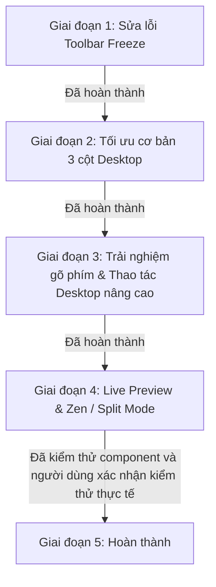

# Báo Cáo Tiến Độ & Kế Hoạch Tối Ưu Giao Diện Chỉnh Sửa Bản Thảo (Chapter Editor)

**Cập nhật lần cuối:** 19/11/2026
**File mục tiêu chính:** [`src/components/author/chapter-editor.tsx`](file:///d:/Vinh_update/src/components/author/chapter-editor.tsx), [`src/components/author/works-sidebar.tsx`](file:///d:/Vinh_update/src/components/author/works-sidebar.tsx), [`src/components/author/publish-panel.tsx`](file:///d:/Vinh_update/src/components/author/publish-panel.tsx)

---

## 1. Tóm tắt hiện trạng quy trình



---

## 2. Các bước ĐÃ HOÀN THÀNH (Done ✅)

### Bước 1: Freeze Toolbar (Ghim thanh công cụ cố định khi cuộn)
- **Vấn đề cũ:** Thanh công cụ nằm bên trong thẻ cuộn `<div ref={scrollerRef} className="flex-1 overflow-y-auto ...">`. Do đó khi tác giả cuộn xuống dưới trang văn bản dài, thanh công cụ bị trôi theo nội dung và biến mất khỏi tầm mắt.
- **Giải pháp đã thực hiện:**
  - Tách toàn bộ cụm Header + Toolbar ra khỏi vùng cuộn `scrollerRef`.
  - Đặt Toolbar thành một khối Header độc lập nằm phía trên container nội dung.
  - Xử lý chuyển đổi linh hoạt: Khi ở chế độ thường dùng `sticky top-0`, khi bật **Chế độ tập trung (Focus Mode)** chuyển sang `relative` (do container cha đã là `fixed inset-0 flex flex-col`).
  - Thêm hiệu ứng kính mờ `bg-surface-warm/95 backdrop-blur-sm shadow-[0_1px_3px_0_rgba(0,0,0,0.06)]` giúp phân tách chuyên nghiệp và sang trọng hơn.

### Bước 2: Tối ưu khả năng hiển thị trên màn hình Desktop & Responsive
- **Sidebar danh sách truyện ([`works-sidebar.tsx`](file:///d:/Vinh_update/src/components/author/works-sidebar.tsx)):**
  - Thêm `lg:overflow-y-auto` để sidebar trên màn hình lớn có thể tự cuộn độc lập khi tác giả có nhiều tác phẩm/bản thảo, không còn kéo lệch layout tổng thể.
- **Thanh trạng thái & nút thao tác:**
  - Ẩn bớt nhãn chữ không cần thiết trên mobile (`hidden sm:inline`), tối ưu không gian nút bấm.
  - Link "Xem trang truyện" hiển thị thông minh trên Desktop (`hidden lg:flex`), tránh làm chật chội trên thiết bị màn hình nhỏ.
  - Giảm chiều cao thanh công cụ từ `min-h-10` xuống `min-h-9` với padding gọn gàng hơn (`py-1`), tăng diện tích hiển thị vùng soạn thảo.
- **Kiểm tra TypeScript:** `npx tsc --noEmit` đã chạy và kiểm tra toàn bộ project (Exit code 0, không có lỗi type).

---

## 3. Bước 3–4: ĐÃ HOÀN THÀNH (Done ✅, 09/10/2026)

### Bước 3: Nâng cao trải nghiệm soạn thảo trên Desktop
- [x] **Phím tắt:** `Ctrl + B` / `Ctrl + I` / `Ctrl + Z` / `Ctrl + Shift + Z`, `Ctrl + Y` đã có từ trước. `Ctrl + S` nay bắt ở cấp khung soạn (không chỉ trong ô nội dung) nên lưu được cả khi con trỏ ở ô tên chương. Tooltip có phím tắt đã có sẵn trên các nút toolbar tương ứng; danh sách đầy đủ ở nút "Phím tắt".
- [x] **Độ rộng trang viết:** nút "Trang rộng / Trang chuẩn" ở header. Chuẩn = 660px (giá trị thực tế, không phải `max-w-3xl`), Rộng = hết khung. Lưu trên trình duyệt (`vinh_editor_layout_v1`, `src/lib/authoring/toolbar-prefs.ts`).
- [x] **Thanh trạng thái chân trang:** số chữ · thời gian đọc · trạng thái lưu (kèm giờ lưu), dính đáy khung soạn ở mọi kích thước màn hình. Trạng thái lưu đã chuyển hẳn từ header xuống đây để không hiện 2 lần.

### Bước 4: Chế độ xem trước song song (Split View)
- [x] Nút "Xem trước" ở header chia đôi: trái soạn, phải hiển thị như độc giả (`src/components/author/chapter-preview.tsx`), dùng chung `chapter-format.ts` với `reader.tsx` (tiêu đề, trích dẫn, ngắt cảnh, đậm/nghiêng, font Lora, giãn dòng 2).
- [x] Cỡ chữ xem trước A−/A+ (15–26px, giống trang đọc). Bản xem trước tự cuộn và tô đoạn đang có con trỏ.
- **Khác so với kế hoạch ban đầu:** không làm tuỳ chọn serif/sans-serif, căn lề, thụt đầu dòng vì trang đọc thật không có các tuỳ chọn này — thêm vào bản xem trước sẽ hiển thị sai so với độc giả. Ảnh thiết kế chỉ hiện ô giữ chỗ "Ảnh thiết kế".
- **Mốc màn hình:** nút Trang rộng / Xem trước chỉ hiện từ 1280px (`xl`) ở chế độ thường (cột soạn kẹp giữa 2 sidebar, ở 1024px chỉ còn ~440px), và từ 1024px (`lg`) khi bật chế độ tập trung. Dưới mốc đó bố cục giữ nguyên như cũ. Link "Xem trang truyện" cũng chuyển sang chỉ hiện từ `xl` để header không chật.

### Kiểm tra đã chạy
- `npx tsc --noEmit`, `npx eslint` các file đã sửa, `npx vitest run` (thêm test `normalizeLayout` trong `toolbar-prefs.test.ts`), `npm run build` — đều qua.

## 4. KIỂM THỬ HOÀN TẤT

### Bước 5: Kiểm thử trình duyệt (19/11/2026)

Đã chạy component `ChapterEditor` thật cùng CSS biên dịch từ `src/app/globals.css` trên Microsoft Edge headless, với bản thảo 100 đoạn (~6.200 chữ) và tên truyện dài. Khung hai sidebar mô phỏng cấu trúc layout tác giả; dữ liệu và callback lưu ở bộ nhớ, không đăng nhập và không ghi vào máy chủ.

- [x] Mobile (375px): thanh trạng thái trong viewport; ẩn nút Trang rộng / Xem trước. Đã xem ảnh chụp màn hình.
- [x] Tablet (768px) và Laptop (1366px): không tràn ngang; header với tên dài xuống dòng và rút gọn hợp lệ; có nút Trang rộng / Xem trước ở 1366px. Đã xem ảnh chụp 1366px.
- [x] Desktop (1366px và 1920px): bản xem trước theo đoạn chứa con trỏ, cuộn độc lập với cột soạn; Trang rộng không cắt nội dung textarea.
- [x] Focus Mode: Ctrl + Shift + F / Esc vào/ra được trên cả 5 kích thước; khoá và phục hồi cuộn trang; Xem trước hoạt động từ 1024px. Toolbar và thanh trạng thái không bị co khi nội dung dài.
- [x] Ctrl + S tại ô tên chương: gọi callback lưu với tên vừa nhập trên cả 5 kích thước.
- [x] Thu nhỏ viewport 375 × 420 trong Focus Mode: thanh trạng thái vẫn trong khung. Đây là kiểm tra bố cục khi đổi chiều cao, không thay thế bàn phím ảo thật.
- [x] Điện thoại thật: mở bàn phím ảo, gõ cuối chương dài, xác nhận con trỏ và chữ không bị bàn phím / thanh trạng thái che, cả chế độ thường và Focus Mode. Người dùng xác nhận đã thử ngày 19/11/2026.
- [x] Phiên tác giả đã đăng nhập: Ctrl + S tại ô tên chương, chờ xác nhận lưu, tải lại trang và kiểm tra tên/nội dung đã tồn tại trên máy chủ. Người dùng xác nhận đã thử ngày 19/11/2026.

### Lỗi phát hiện và đã sửa

Khung desktop chưa được giới hạn chiều cao theo màn hình và cột grid còn phụ thuộc kích thước nội dung. Chương dài vì thế có thể kéo cả trang, làm mất khả năng cuộn độc lập của bản xem trước. Đã thêm `lg:h-dvh`, giới hạn chiều rộng cột bằng `minmax(0,1fr)`, cho editor co bằng `min-h-0 min-w-0`, và chống co toolbar / thanh trạng thái bằng `shrink-0`. Mobile vẫn cuộn theo trang ở chế độ thường.

### Chạy lại kiểm thử

```sh
node scripts/test-chapter-editor-ui.mjs <đường-dẫn-playwright-core/index.mjs>
npx tsc --noEmit
npx eslint src/components/author/chapter-editor.tsx src/app/author/layout.tsx scripts/test-chapter-editor-ui.mjs
npx vitest run src/lib/authoring/toolbar-prefs.test.ts src/lib/reading/chapter-format.test.ts
```

Script dùng `esbuild`, PostCSS/Tailwind và bản Playwright có sẵn trên máy; không tải thêm dependency. Kết quả và ảnh chụp sinh tại `.tmp/chapter-editor/` (đã được bỏ qua bởi Git). Kết quả 5 viewport: **375, 768, 1024, 1366, 1920px đều qua**. TypeScript, ESLint và 14 test định dạng / tuỳ chọn bố cục đều qua.

Hai mục kiểm thử thiết bị thật và phiên đăng nhập do người dùng thực hiện và xác nhận, không phải kết quả suy ra từ kiểm thử component. Production build ở lần kiểm tra trước bị chặn do không tải được Google Fonts; cần kiểm tra kết quả build trên Vercel sau khi đẩy mã nguồn.
